# Documento Conceptual y Diagnóstico de Auditoría Goldfish (EGM)
## Pipeline Fase 19 (Córtex de IA), Telemetría Fases 1–18, Portal Longitudinal (`client_followup/`) y Cumplimiento NOM-004

> **Ubicación:** `docs/designs/concepts_brief.md`  
> **Fecha:** Noviembre 2026  
> **Ecosistema:** T.I.L.O.® & Equipo en Acción® (*Transformación Inteligente y Logro Optimizado*)  
> **Estado:** Fase de Brainstorming Arquitectónico (`/egm:egm-brainstorm`)  
> **Normativa Base:** [`docs/designs/goldfish_context.md`](file:///c:/Users/andre/App%20de%20consulta%20nutricional/docs/designs/goldfish_context.md), [`README.md`](file:///c:/Users/andre/App%20de%20consulta%20nutricional/README.md) y `clinical-branding-guide`

---

## 1. Resumen Ejecutivo y Diagnóstico Global

El enjambre de auditoría Goldfish (`egm-codebase-details` y `egm-design`) ejecutó una inspección exhaustiva y no destructiva sobre el pipeline de la Fase 19 (Córtex de IA), el backend (`server/controllers/cortexController.js`, `server/index.js`, `server/routes/`), el hub sensorial de Python (`server_py/`) y el portal de seguimiento (`client_followup/`), manteniendo blindadas al 100% las Fases 0 a 18 de la App 1 (`client/`).

### Matriz de Dictamen Global

| Eje Evaluado | Diagnóstico Técnico | Severidad | Veredicto |
| :--- | :--- | :--- | :--- |
| **1. Pipeline Fase 19 & Fases 1–18** | Pérdida de más del 70% de la anamnesis (AHF, APP, hábitos, crononutrición R24H, TA) por poda agresiva en red y ceguera de `distillClinicalSerum`. | 🔴 Blocker | **CRITICAL FAIL** |
| **2. Prescripción Ortomolecular & Dieta** | Ausencia en backend de "Super Malla Biológica Tropical", falta de prescripción estructurada NutriKeto y omisión de reglas 0 Picante, 0 Cerdo, 0 Azúcares. | 🔴 Blocker | **CRITICAL FAIL** |
| **3. Portal de Revaloración (`client_followup`)** | Estado y notas SOAP 100% hardcodeados (lactante de 12 meses fija); snapshot basal devuelto por SQLite es descartado; motor delta cuántico inexistente. | 🔴 Blocker | **CRITICAL FAIL** |
| **4. Integración Sensorial `server_py`** | Desconexión total de los agentes `AgentClarisa`, `AgentSpark` y `AgentTracker` respecto a la síntesis diagnóstica en Node.js; duplicación de inferencia. | 🟠 Major | **FLAGGED** |
| **5. Normativa NOM-004 & Criptoseguridad** | Snapshot guardado en SQLite en JSON plano sin cifrado AES-256-GCM; carencia de bitácora SHA-256 Hash Chain; PENULTIMATE-LAST desatendido en follow-up. | 🔴 Blocker | **CRITICAL FAIL** |
| **6. `clinical-branding-guide` & UX** | Sombras negras puras por defecto en Tailwind v4 (`#000000`); controles táctiles < 48px; falta de confirmación secundaria con 12px margin en Rojo 33Plus®. | 🟡 Major | **FLAGGED** |

---

## 2. Mapa Detallado de Telemetría: Fases 1 a 18 vs. Córtex de la Fase 19

A continuación se detalla con precisión quirúrgica el flujo de datos desde el estado acumulado del paciente en el frontend (`patientData`) hasta el motor de síntesis de la Fase 19 en el backend (`server/controllers/cortexController.js`).

```mermaid
flowchart TD
    subgraph Frontend Accumulator ["App 1: Estado Acumulado (Fases 1–18)"]
        F1["Fase 1: Identificación & Demografía"]
        F2["Fase 2: Domicilio & CP"]
        F3["Fase 3: Motivo Principal & Anclaje Emocional"]
        F4["Fase 4: Antecedentes Heredofamiliares (AHF)"]
        F56["Fases 5-6: Antecedentes Personales Patológicos (APP) & Cirugías"]
        F7["Fase 7: Alergias Alimentos & Medicamentos"]
        F8["Fase 8: Salud Digestiva (Roma IV)"]
        F9["Fase 9: Gineco-Obstétrico / Fisiológico"]
        F10_11["Fases 10-11: Toxicomanías, Sueño & Estrés"]
        F12_13["Fases 12-13: Preferencias, Aversiones & Logística"]
        F14["Fase 14: Crononutrición R24H"]
        F15["Fase 15: Frecuencia de Consumo (FFQ)"]
        F16["Fase 16: Biometría & Composición Corporal"]
        F17["Fase 17: Signos Vitales (TA, FC, SpO2, Temp)"]
        F18["Fase 18: Escáner Electret (36 cats/245 biomarcadores), Ocular, Lingual, OCR"]
    end

    subgraph PruningLayer ["Fase 19 Frontend: pruneTelemetryPayloadForNetwork"]
        PruneFilter["Filtro de Red (< 12 KB)<br/>Descarta biomarcadores NORMALES<br/>Trunca telemetría Electret & OCR"]
    end

    subgraph BackendCortex ["server/controllers/cortexController.js"]
        Distill["distillClinicalSerum()"]
        Bioenergetics["calculatePrecisionBioenergetics()"]
        GeminiNodes["synthesizeNodeWithGemini()<br/>(Inferencia Concurrente por Lotes)"]
        Prescription["buildOrthomolecularPrescription()"]
    end

    F18 --> PruneFilter --> Distill
    F7 --> Distill
    F8 --> Distill
    F1 --> Bioenergetics
    F16 --> Bioenergetics
    
    F3 -.->|Solo regex de ruta| Distill
    F4 -.-x|PERDIDO: Omitido al 100%| Distill
    F56 -.-x|PERDIDO: Omitido al 100%| Distill
    F9 -.-x|PERDIDO: Omitido en IFM| Distill
    F10_11 -.-x|PERDIDO: Sueño y estrés omitidos| Distill
    F12_13 -.-x|PERDIDO: Cero ingesta| Distill
    F14 -.-x|PERDIDO: Cero ingesta| Distill
    F15 -.-x|PERDIDO: Cero ingesta| Distill
    F17 -.-x|PERDIDO: TA y Temp omitidas| Distill

    Distill --> GeminiNodes
    Bioenergetics --> Prescription
    GeminiNodes --> Prescription
```



### Tabla Comparativa de Telemetría Clínica: Qué SÍ llega vs. Qué se PIERDE

| Fase Clínica | Datos Capturados en Cliente | Estado en `pruneTelemetryPayloadForNetwork` | Estado en `cortexController.js` (`distillClinicalSerum`) | Impacto Clínico y Falla de Precisión |
| :--- | :--- | :--- | :--- | :--- |
| **Fase 1: Identificación** | Nombre legal, edad, fecha nac, sexo, ocupación, factor PAL ocupacional | Se envía en `identityLock` y raíz | Se extrae edad/meses y sexo para bioenergética | **LLEGA PARCIAL**. Nombre no se formatea bajo PENULTIMATE-LAST. |
| **Fase 2: Domicilio** | Código postal, colonia, municipio, estado | Se envía en raíz | Ignorado en el destilador | **SUBUTILIZADO**. Sin impacto clínico crítico. |
| **Fase 3: Motivo de Consulta** | Cita textual del paciente (`patient_quote`), padecimiento específico, ancla emocional, sospecha | Se envía en `clinical_context` | Solo se ejecuta un `.includes("PESO")`, etc. para fijar `determinedRoute` | **CRÍTICO: SE PIERDE**. El LLM de los 7 Nodos jamás lee la voz del paciente ni su sufrimiento clínico reportado. |
| **Fase 4: AHF (Heredofamiliares)** | Diabetes, hipertensión, infarto temprano, cáncer, dislipidemia en padres/abuelos | Se envía en `history.family_structured` | **OMITIDO AL 100%**. Ninguna línea de `distillClinicalSerum` lee antecedentes familiares | **CRÍTICO: SE PIERDE**. Riesgo bayesiano genético no modula los Nodos 3 (Bioenergética) ni 5 (Transporte/Cardio). |
| **Fases 5–6: APP y Cirugías** | Cirugías previas (colecistectomía, bypass), diagnósticos crónicos, medicación | Se envía en `history.personal_structured` | Solo lee `history.medications` para candado de anfetamínicos (NOM-028) | **CRÍTICO: SE PIERDE**. Un paciente colecistectomizado no recibe alerta biliar en Nodo 1 ni Nodo 2. |
| **Fase 7: Alergias** | Alergias alimentarias y farmacológicas | Se envía en `history.allergies` | Se procesan como anomalías en Nodo 6 (Defensa) | **SÍ LLEGA**. Adecuadamente integrado. |
| **Fase 8: Salud Digestiva** | Síntomas Roma IV (distensión, estreñimiento, diarrea, reflujo) | Se envía en `digestive_profile` | Se procesa como anomalía en Nodo 1 (Asimilación) | **SÍ LLEGA**. Adecuadamente integrado. |
| **Fase 9: Gineco-Obstétrico** | Semanas de gestación, lactancia, edad del bebé | Se envía en `physio` | Solo se extrae flag de lactante | **SUBUTILIZADO**. Gestantes no modulan requerimientos específicos en IFM. |
| **Fases 10–11: Toxicomanías & Sueño** | Cigarros/día, consumo de alcohol (g/sem), horas de sueño, insomnio, estrés percibido | Se envía en `habits` | Solo se extrae `activity_level` para el PAL | **CRÍTICO: SE PIERDE**. La cronodisrupción y el estrés suprarrenal no llegan a Nodos 4 (Comunicación) ni 6 (Inmune). |
| **Fases 12–13: Preferencias Dietéticas** | Aversiones, alimentos favoritos, logística culinaria | Se envía en `nutrition` | Omitido en `distillClinicalSerum` | **SE PIERDE**. El plan nutricional no filtra aversiones declaradas. |
| **Fase 14: Crononutrición R24H** | Desglose de comidas de 24h, horarios de ingesta, ayuno intermitente | Se envía en `evaluacionDietetica.r24h` | Omitido en `distillClinicalSerum` | **CRÍTICO: SE PIERDE**. Desalineación circadiana nutricional no es evaluada. |
| **Fase 15: FFQ Frecuencia** | Frecuencia de ultraprocesados, harinas, carnes rojas, refrescos | Se envía en `evaluacionDietetica.ffq` | Omitido en `distillClinicalSerum` | **CRÍTICO: SE PIERDE**. Cero correlación entre ingesta de azúcares/grasas y disbiosis/lípidos. |
| **Fase 16: Biometría General** | Peso, talla, grasa %, masa muscular, cintura, cadera, ICC | Se envía en `vitals` y raíz | Peso, talla y grasa % van a bioenergética; cintura/cadera/ICC omitidos | **PARCIAL / SUBUTILIZADO**. El riesgo metabólico androide/ginecoide por ICC no entra al Nodo 5. |
| **Fase 17: Signos Vitales** | TA (sistólica/diastólica), FC, SpO2, temperatura, glucosa capilar | Se envía en `signosVitales` y `vitals` | Únicamente se lee `heart_rate` para bradicardia (< 60) | **CRÍTICO: SE PIERDE**. Un paciente con Presión Arterial 150/95 mmHg es clasificado en HOMEOSTASIS si Electret no alertó reología. |
| **Fase 18: Escáner Electret & Visión** | 36 categorías, 245 biomarcadores bioeléctricos, ocular, lingual, somática, OCR labs | Se podan y descartan los valores NORMALES; solo anomalías viajan | Se mapean anomalías a los 7 Nodos IFM | **PARCIALMENTE MUTILADO**. Se pierde la línea base de normalidad requerida para comparar en el seguimiento a 28 días. |

---

## 3. Prescripción Ortomolecular y Protocolo NutriKeto

### Falencias Detectadas:
1. **Omisión de la "Super Malla Biológica Tropical":**
   - Aunque `SafetyEngine.js` la define como un suplemento natural antiinflamatorio (extracto concentrado de Jengibre y Cúrcuma con marcadores de bioseguridad anticoagulante e hipoglucemiante), `cortexController.js:buildOrthomolecularPrescription` jamás la prescribe ni evalúa su interacción.
2. **Ausencia del Plan Nutricional "NutriKeto":**
   - La respuesta del Córtex en Fase 19 entrega una distribución genérica de macronutrientes (`macros.carbs`, `macros.protein`, `macros.fat`), sin emitir las fases estructuradas de inducción, cetoadaptación y flexibilidad metabólica de la doctrina NutriKeto.
3. **Omisión de las Tres Reglas Inviolables de Exclusión Clínica:**
   - La normativa institucional del proyecto exige estampar de forma no negociable:
     - **0 Picante**
     - **0 Cerdo**
     - **0 Azúcares refinados**
   - Actualmente, en `cortexController.js`, `suggested_management` no explicita estas prohibiciones, y en `ClinicalRules.js`, "CERDO" solo se restringe a minorías religiosas, violando la regla inmutable de que en el ecosistema T.I.L.O. el cerdo, el picante y los azúcares refinados están prohibidos de forma universal para todo paciente.

---

## 4. Diagnóstico del Portal de Revaloración (`client_followup/`)

### 1. Mocking Pediátrico Hardcodeado Inaceptable:
* En `client_followup/src/App.jsx` (líneas 48–56):
  ```javascript
  const patientData = {
    identificacion: {
      nombre: isIdentityConfirmed ? sessionInfo.patientName : "---",
      edad: "12 Meses",
      sexo: "Femenino",
      usuarioId: sessionInfo.userId || "---",
      citaId: sessionInfo.citation || "---"
    }
  };
  ```
* En `client_followup/src/components/EvolutionNoteSOAP.jsx`:
  - Se visualizan textos fijos sobre un lactante con ablactación guiada BLW, papillas monocomponente y lactancia materna, incluso si el paciente logueado es un adulto masculino de 55 años con síndrome metabólico.
  - Se reporta una Presión Arterial fija de `118/76 mmHg` y se prescribe `33Plus® Ignición` matutina a un bebé ficticio, lo cual es una aberración clínica.

### 2. Descarte del Snapshot Basal ($T_0$) de SQLite:
* El endpoint `/api/followup/validate-citation` en `server/index.js` rescata exitosamente el registro completo de la consulta basal (`userHistory.patient_data_snapshot`) y lo envía en `data.patientData.info`.
* Sin embargo, `client_followup/src/App.jsx` solo almacena `userId` e `idCita`, descartando el objeto `info`.

### 3. Motor Delta Electret Simulado e Inoperante:
* `client_followup/src/hooks/useDeltaElectret.js` ignora el argumento `basalSnapshot` y corre un `setTimeout` con 4 constantes numéricas arbitrarias (`inflamacionCelular: 68.4` vs `42.1`), sin realizar ninguna correlación matemática sobre las 36 categorías o los 245 biomarcadores del escáner cuántico.

---

## 5. Arquitectura de Microservicios: Node.js Express vs. Python FastAPI (`server_py/`)

### Desconexión y Duplicación Sensorial:
* `server_py/` dispone de agentes de alta precisión en Python:
  - **`AgentClarisa`:** Analizador oculómico y lingual en Gemini 1.5 Pro con extracción de vectores contrafactuales StyleX (`conjunctival_pallor`, `eyelid_margin_pallor`, `toothmarks_depth`, `coating_density`).
  - **`AgentSpark`:** Extractor OCR de capturas de pantallas fitness (Zepp, Strava, Apple Health).
  - **`AgentTracker`:** Parser cinemático de archivos TCX/GPX con cálculo de distancia Haversine, calorías y zonas cardíacas.
* **El Problema:** El backend Node.js (`server/`) jamás consume a `server_py`. En su lugar, `bioRoutes.js` implementa llamadas directas a Gemini y procesamiento con Sharp, duplicando la lógica de IA y dejando huérfanos a los agentes de telemetría deportiva y StyleX en FastAPI.

---

## 6. Cumplimiento de `clinical-branding-guide`

1. **Sombras Negras Puras Prohibidas:**
   - En `client_followup/src/index.css` no se anulan los tokens `--shadow-*` de Tailwind v4. Clases como `shadow-sm`, `shadow-md` y `shadow-xs` en las tarjetas clínicas aplican negro puro (`rgba(0,0,0,...)`). Debe migrarse a elevaciones calibradas en Slate-900 (`#0F172A`).
2. **Ergonomía Táctil y Hit Margin:**
   - Botón de envío en `client_followup/src/App.jsx#L475` mide `w-10 h-10` (40px x 40px), violando el estándar de `48px x 48px` con Hit Margin de 8–12px.
   - Opciones del chat y botones de exportación operan por debajo de los 44–48px mínimos.
3. **Bioseguridad en Acento Rojo 33Plus® (`#B70E0C`):**
   - El botón de confirmación o acción crítica vinculada a la ignición termogénica 33Plus® carece de Hit Margin de 12px y de confirmación secundaria obligatoria (doble pulsación o *slide-to-confirm*).

---

## 7. Trazabilidad y Normativa NOM-004

1. **Cifrado en Reposo Inexistente:**
   - En `server/db.js` y `server/schema.sql`, la tabla `session_persistence` almacena `patient_data_snapshot` como texto plano JSON (`TEXT`). Esto viola la LFPDPPP y la NOM-004 para expedientes clínicos electrónicos. Se requiere cifrado criptográfico simétrico **AES-256-GCM**.
2. **Carencia de Bitácora Inmutable (SHA-256 Hash Chain):**
   - Al aprobarse el dossier en `approveDossier` o generarse una nota SOAP, no se registra ningún encadenamiento criptográfico (`prevHash` + `metadata` $\rightarrow$ `currentHash`).
3. **Algoritmo PENULTIMATE-LAST Desatendido:**
   - Tanto en el login como en el encabezado de `client_followup`, el nombre viaja como cadena única (`patientName`), sin descomponer legalmente Primer Apellido, Segundo Apellido y Nombre(s).

---

## 8. Propuestas de Arquitectura y Soluciones de Mayor Impacto

Para la fase de diseño técnico e implementación, el enjambre Goldfish propone estructurar las siguientes soluciones priorizadas:

### 🌟 Prioridad P0: Soluciones Bloqueantes Inmediatas

1. **Contrato `ClinicalStateSnapshot` y Destilador IFM 360° en Fase 19:**
   - Expandir `distillClinicalSerum` en `server/controllers/cortexController.js` para ingestar la totalidad de las 18 fases previas:
     - Inyectar antecedentes familiares (Fase 4) en Nodos 3 y 5.
     - Inyectar antecedentes quirúrgicos/patológicos (Fase 6) en Nodos 1 y 2.
     - Inyectar cronodisrupción, horas de sueño y estrés (Fases 10–11) en Nodos 4 y 6.
     - Inyectar Presión Arterial basal (Fase 17) directamente en el Nodo 5 (Transporte/Hemodinámica).
     - Incorporar el motivo de consulta textual (Fase 3) en el prompt de síntesis diagnóstica.
2. **Prescripción Completa y Reglas Inmutables:**
   - Integrar la **Super Malla Biológica Tropical** (Cúrcuma + Jengibre microencapsulados) en `buildOrthomolecularPrescription` cruzando con `SafetyEngine.js`.
   - Incorporar el protocolo **NutriKeto** en la síntesis terapéutica y estampar de forma universal en todo plan: **0 Picante, 0 Cerdo y 0 Azúcares refinados**.
3. **Erradicación del Mocking Pediátrico y Gemelo Digital Evolutivo en `client_followup`:**
   - Ingestar el snapshot basal real $T_0$ recibido desde SQLite en `client_followup/src/App.jsx`.
   - Crear el endpoint de cálculo cuántico `/api/followup/longitudinal-compare` que contraste matemáticamente los 245 biomarcadores y 36 categorías de Electret entre $T_0$ y $T_1$, calculando $\Delta\%$ reales y el *Bioelectric Recovery Score (BRS)* genuino.
   - Dinamizar al 100% `EvolutionNoteSOAP.jsx` consumiendo los datos reales del paciente, su anamnesis, su diagnóstico de Fase 19 y su telemetría longitudinal de 28 días.

### ⚡ Prioridad P1: Robustecimiento de Infraestructura y Gobernanza

4. **Arquitectura Hub & Spoke (Node.js BFF ➔ FastAPI Sensory Hub):**
   - Establecer a Express (`server/`) como Backend-for-Frontend y a FastAPI (`server_py/`) como el motor de ingestión profunda: Node.js delega a `server_py` el análisis de StyleX en imágenes oculares/linguales y el parsing de telemetría wearable (TCX/GPX).
5. **Gobernanza Visual y Ergonómica (`clinical-branding-guide`):**
   - Configurar tokens de sombra basados en Slate-900 (`#0F172A`) en `client_followup/src/index.css`.
   - Elevar todos los touch targets a un mínimo de `48px x 48px`.
   - Implementar el componente `BiosecureActionButton` para toda acción crítica con acento Rojo 33Plus® (Hit Margin de 12px + patrón de confirmación secundaria: doble toque o deslizamiento).
6. **Blindaje Criptográfico NOM-004:**
   - Implementar helper de cifrado simétrico AES-256-GCM para la persistencia del expediente en SQLite (`session_persistence`).
   - Crear la tabla `audit_ledger` en SQLite con encadenamiento SHA-256 (`prevHash`, `currentHash`, `timestamp`, `actorId`).

---

*Documento conceptual aprobado por el enjambre Goldfish para la apertura de la fase de diseño técnico e implementación.*
