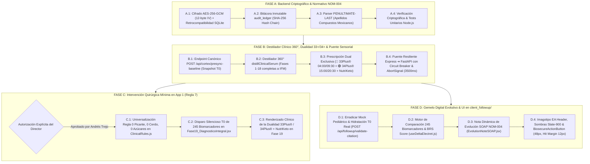

# Plan de Implementación Técnica Detallado (Implementation Plan)
## Ecosistema T.I.L.O.® & Equipo en Acción® — Protocolo Elephant-Goldfish Model (EGM)

> **Ubicación:** `docs/designs/implementation_plan.md`  
> **Versión:** 1.0.0-PROPOSAL  
> **Fecha:** Noviembre 2026  
> **Acrónimo Institucional:** **T.I.L.O.® = "Transformación Inteligente y Logro Optimizado"**  
> **Documento de Diseño Aprobado:** [`docs/designs/design_draft.md`](file:///c:/Users/andre/App%20de%20consulta%20nutricional/docs/designs/design_draft.md) (v3.2.0-CONSOLIDATED)  
> **Dictamen Colegiado de Auditoría:** [`docs/designs/consolidated_review_report.md`](file:///c:/Users/andre/App%20de%20consulta%20nutricional/docs/designs/consolidated_review_report.md)  
> **Marco de Gobernanza Inviolable:** [`.agents/AGENTS.md`](file:///c:/Users/andre/App%20de%20consulta%20nutricional/.agents/AGENTS.md) (Reglas 1, 2, 3, 6 y 7), [`docs/designs/goldfish_context.md`](file:///c:/Users/andre/App%20de%20consulta%20nutricional/docs/designs/goldfish_context.md) y `clinical-branding-guide`.  
> **Principio de Inviolabilidad:** La UI y flujos clínicos de las Fases 0 a la 18 de la App 1 (`client/`) permanecen **100% blindados e inmutables**.

---

## 🔒 0. Protocolo de Gobernanza y Salvaguardas Institucionales (Regla 7 de `.agents/AGENTS.md`)

De conformidad estricta con la **Regla Inmutable 7 de `.agents/AGENTS.md`**:
1. **Blindaje de la App de Consulta Nutricional (`client/`):** La App 1 se declara oficialmente completa y funcional. Las Fases 0 a 18 están bajo congelamiento absoluto de código (cero modificaciones en rutas, componentes, hooks o estilos).
2. **Protocolo de Autorización Escrita:** La ejecución de la **FASE C** (intervención mínima quirúrgica en `client/src/ClinicalRules.js` y `client/src/components/interview/Fase19_DiagnosticoIntegral.jsx`) requerirá la autorización expresa, afirmativa y por escrito del Director (Andrés Trejo) una vez revisado este plan.
3. **Invarianza Funcional:** Queda prohibido alterar o degradar la fidelidad de las 36 categorías y los 245 biomarcadores del escáner cuántico bioeléctrico Electret, ni las reglas de exclusión universales (0 Picante, 0 Cerdo, 0 Azúcares refinados).

---

## 🗺️ 1. Matriz de Fases de Ejecución y Dependencias



---

## 🛠️ 2. Desglose Quirúrgico Paso a Paso

---

### FASE A: Backend Criptográfico y Normativo NOM-004
**Archivos Afectados:**
- 🆕 `server/utils/cryptoVault.js` (Nuevo módulo de bóveda criptográfica)
- 🆕 `server/utils/nom004Utils.js` (Nuevo módulo de normalización onomástica)
- 🛠️ `server/db.js` (Inicialización de tabla `audit_ledger`)
- 🛠️ `server/index.js` (Integración de cifrado en endpoints de persistencia)

#### Paso A.1: Crear la Bóveda Criptográfica Retrocompatible (`server/utils/cryptoVault.js`)
* **Implementación:**
  1. Clave de cifrado AES-256 de 32 bytes derivada de `process.env.CLINICAL_ENCRYPTION_KEY` con fallback seguro de desarrollo.
  2. `encryptClinicalData(plainText)`: Generación de IV de exactamente **12 bytes (96 bits)** con `crypto.randomBytes(12)` conforme a NIST SP 800-38D. Cifrado en modo GCM, extracción del `authTag` de 16 bytes y retorno en formato `iv:authTag:encrypted`.
  3. `decryptClinicalData(cipherText)`: **Filtro de retrocompatibilidad síncrono**. Si la cadena inicia con `{` o `[` o no contiene exactamente dos separadores `:`, se retorna el texto plano sin arrojar error. Si tiene el formato de 3 partes, se descifra mediante `createDecipheriv('aes-256-gcm', ...)` validando la integridad del `authTag`.

#### Paso A.2: Crear el Libro Mayor Inmutable SHA-256 Hash Chain (`audit_ledger`)
* **Implementación:**
  1. En `server/utils/cryptoVault.js`, ejecutar la creación de tabla:
     ```sql
     CREATE TABLE IF NOT EXISTS audit_ledger (
         id INTEGER PRIMARY KEY AUTOINCREMENT,
         timestamp DATETIME DEFAULT CURRENT_TIMESTAMP,
         actor_id TEXT NOT NULL,
         action TEXT NOT NULL,
         patient_id TEXT NOT NULL,
         payload_hash TEXT NOT NULL,
         prev_hash TEXT NOT NULL,
         current_hash TEXT NOT NULL
     );
     ```
  2. `appendAuditLedger({ actorId, action, patientId, payload })`: Obtiene el `current_hash` del último registro (o el bloque génesis `0000...0000`), calcula `payload_hash = SHA256(payloadStr)` y computa:
     $$\text{currentHash} = \text{SHA256}(\text{prevHash} + \text{timestamp} + \text{actorId} + \text{action} + \text{patientId} + \text{payloadHash})$$
     Inserta el registro y devuelve los metadatos auditables.
  3. `verifyLedgerIntegrity()`: Recorre secuencialmente todos los registros en SQLite verificando que cada `prev_hash` coincida con el hash anterior y recalculando cada `current_hash`.

#### Paso A.3: Normalizador Onomástico PENULTIMATE-LAST (`server/utils/nom004Utils.js`)
* **Implementación:**
  1. Expresión regular pre-tokenizadora:
     ```javascript
     const normalized = clean.replace(/\b(de\s+la|de\s+las|de\s+los|de|del|san|santa)\s+/gi, match => `${match.trim()}_`);
     ```
  2. Partición por espacios en blanco y restitución de guiones bajos a espacios.
  3. Aplicación de la regla legal:
     - 1 token: Nombre de Pila.
     - 2 tokens: Nombre de Pila + Apellido Paterno.
     - 3 tokens: Nombre de Pila + Apellido Paterno + Apellido Materno.
     - $\ge$ 4 tokens: `tokens[length - 2]` es Paterno, `tokens[length - 1]` es Materno, `tokens[0 ... length - 3]` es Nombre de Pila.

#### Paso A.4: Verificación de Fase A
* **Comando de verificación:** Ejecutar script scratch temporal en Node.js que pruebe cifrado, descifrado con JSON plano legado, integridad de 5 bloques en `audit_ledger`, y casos onomásticos ("Juan De la Torre Flores", "María de los Ángeles San Martín Peña").

---

### FASE B: Destilador Clínico 360°, Dualidad 33Plus®/34Plus® y Puente Sensorial
**Archivos Afectados:**
- 🛠️ `server/controllers/cortexController.js` (Destilador 360° y Prescripción Dual)
- 🛠️ `server/routes/cortexRoutes.js` (Endpoint `POST /api/cortex/presync-baseline`)
- 🆕 `server/services/sensoryBridge.js` (Despachador Express ➔ FastAPI con Circuit Breaker)
- 🛠️ `server/index.js` (Montaje y registro de servicios)

#### Paso B.1: Endpoint Canónico de Presincronización Basal $T_0$
* **Implementación:**
  - Registrar en `server/routes/cortexRoutes.js`:
    ```javascript
    router.post('/presync-baseline', cortexController.presyncBaselineSnapshot);
    ```
  - `presyncBaselineSnapshot(req, res)`:
    1. Recibe `{ citationId, rawPatientData, electret245Baseline }`.
    2. Valida la presencia de `citationId`.
    3. Cifra el snapshot íntegro con `cryptoVault.encryptClinicalData`.
    4. Ejecuta un UPSERT en `session_persistence` almacenando el snapshot basal inalterado ($T_0$) para que la revaloración a 28 días disponga de los 245 biomarcadores.
    5. Registra el evento en `audit_ledger` mediante `cryptoVault.appendAuditLedger`.
    6. Retorna `{ success: true, timestamp, baselineCount: 245 }`.

#### Paso B.2: Destilador Clínico 360° en `server/controllers/cortexController.js`
* **Implementación:**
  1. Inicializar estrictamente `let hasHighSerumCalciumOrCalcification = false;`.
  2. Implementar la ingesta defensiva (`Array.isArray()`) de:
     - **Fase 3:** `clinical_context.patient_quote`, `specific_ailment`, `emotional_anchor` $\rightarrow$ Nodo 4 (Comunicación).
     - **Fase 4:** Antecedentes Heredofamiliares $\rightarrow$ Nodos 3 (Energía/Metabólico), 5 (Transporte/Cardio), 6 (Defensa/Inmune).
     - **Fases 5-6:** Patológicos y cirugías (ej. Colecistectomía $\rightarrow$ Nodo 1 con alerta de sobrecarga biliar).
     - **Fase 9:** Gestación y lactancia (`patientData.physio?.gestation_weeks`, `is_pregnant`, `is_lactating`) $\rightarrow$ Nodos 3 y 4.
     - **Fases 10-11:** Sueño, insomnio, estrés alostático y toxicomanías $\rightarrow$ Nodos 2 y 4.
     - **Fases 12-13:** Aversiones, alergias y exclusiones (`patientData.nutrition.preferences.excluded_ingredients` y `patientData.evaluacionDietetica.preferencias.aversiones`) $\rightarrow$ Lista consolidada `combinedExclusions`.
     - **Fases 16-17:** Antropometría (Cintura, Cadera, ICC) y Signos Vitales (TA sistólica/diastólica, Glucosa capilar, Temperatura) $\rightarrow$ Nodos 3 y 5.
     - **Fase 18:** Escáner bioeléctrico Electret, fotos oculares, fotos linguales y labs OCR $\rightarrow$ Nodos 1 a 7 con detección de calcificación.

#### Paso B.3: Prescripción Dual Exclusiva y Reglas Universales NutriKeto
* **Implementación:**
  - Actualizar `buildOrthomolecularPrescription` en `cortexController.js`:
    - **Cuarentena estricta:** Cero mención a fórmulas experimentales o "Super Malla Biológica Tropical".
    - **Regla Universal Dietética:** NutriKeto con **0 Picante, 0 Cerdo y 0 Azúcares refinados** para todo paciente + exclusiones particulares (`combinedExclusions`).
    - **Cronobiología Circadiana de 4 Tomas:**
      * **Toma 1 (04:00 hrs):** 🔴 33Plus® (10g en 300 ml de agua tibia).
      * **Toma 2 (09:30 hrs):** 🔴 33Plus® (10g en 300 ml de agua templada).
      * **Toma 3 (15:00 hrs):** 🟢 34Plus® (10g en 500 ml de agua purificada 💧).
      * **Toma 4 (20:30 hrs):** 🟢 34Plus® (10g en 500 ml de agua purificada 💧).
      * Conmutación NOM-028 a variante descafeinada si hay riesgo adictivo o hipertensión severa en gestación.

#### Paso B.4: Despachador Sensorial con Circuit Breaker (`server/services/sensoryBridge.js`)
* **Implementación:**
  1. Clase `SensoryCircuitBreaker`: umbral de 2 fallas, enfriamiento de 60 segundos (`CLOSED`, `OPEN`, `HALF_OPEN`).
  2. Función unificada `callSensoryHubWithFallback(endpoint, body, localFallbackFn)`:
     - Si circuito está abierto, ejecuta inmediatamente `localFallbackFn()`.
     - Ejecuta petición HTTP a `http://localhost:8000` con `signal: AbortSignal.timeout(3500)`.
     - Si ocurre error o timeout, registra la falla y conmuta al fallback local de Gemini Flash en Node.js.

---

### FASE C: Intervención Quirúrgica Mínima en App 1 (Bajo Regla 7)
> [!CAUTION]
> **Condición Bloqueante de Ejecución:** Esta fase solo se ejecutará cuando el Director apruebe por escrito este plan. Las Fases 0 a 18 permanecen 100% inalterables.

**Archivos Afectados:**
- 🛠️ `client/src/ClinicalRules.js` (Restricciones dietéticas universales)
- 🛠️ `client/src/components/interview/Fase19_DiagnosticoIntegral.jsx` (Sincronización $T_0$ y visualización dual)

#### Paso C.1: Sellar las 3 Reglas Universales en `client/src/ClinicalRules.js`
* **Implementación:**
  - En `generateSecurityConstraints(religion, bmiValue)`:
    - Asegurar que `'PICANTE'`, `'CERDO'` y `'AZUCARES_REFINADOS'` se inyecten de forma universal en `constraints.forbidden_ingredients` para todos los pacientes, independientemente de la religión o IMC, preservando las reglas específicas adicionales por religión.

#### Paso C.2: Disparo Silencioso de Presincronización $T_0$ en `Fase19_DiagnosticoIntegral.jsx`
* **Implementación:**
  - Al montar la Fase 19 (`useEffect`), disparar una llamada asíncrona síncrona/no bloqueante hacia `POST /api/cortex/presync-baseline` enviando el snapshot completo acumulado de las Fases 1 a la 18 y el escáner Electret con sus 245 biomarcadores íntegros.
  - Proceder con `pruneTelemetryPayloadForNetwork` para el envío a Gemini, garantizando que el expediente médico $T_0$ quede blindado en SQLite antes de cualquier compresión visual.

#### Paso C.3: Visualización de la Prescripción Dual 33Plus® / 34Plus® en UI
* **Implementación:**
  - En la tarjeta de prescripción ortomolecular de la Fase 19, desplegar el cronograma de 4 tomas (04:00, 09:30, 15:00 y 20:30 hrs) con sus respectivos volúmenes hídricos (300 ml agua tibia para 🔴 33Plus® y $\ge 500\text{ ml}$ para 🟢 34Plus®) y el régimen NutriKeto sin picante, cerdo ni azúcares.

---

### FASE D: Gemelo Digital Evolutivo y Gobernanza Visual en `client_followup/`
**Archivos Afectados:**
- 🛠️ `client_followup/src/App.jsx` (Hidratación real $T_0$, erradicación de mock pediátrico, Header oficial)
- 🛠️ `client_followup/src/hooks/useDeltaElectret.js` (Cálculo delta de 245 biomarcadores y BRS Score)
- 🛠️ `client_followup/src/components/EvolutionNoteSOAP.jsx` (Nota evolutiva NOM-004 dinámica)
- 🛠️ `client_followup/src/index.css` (Tokens Tailwind v4 Slate-900, cero `#000000`)
- 🆕 `client_followup/src/components/ui/BiosecureActionButton.jsx` (Botón con Hit Margin de 12px y doble confirmación)

#### Paso D.1: Hidratación Basal $T_0$ Real en `client_followup/src/App.jsx`
* **Implementación:**
  1. Eliminar los valores hardcodeados (`age: 12 meses`, `sex: 'F'`).
  2. Al autenticar la cita (`validateCitation`), leer el snapshot basal $T_0$ retornado por el backend desde SQLite (`session_persistence`).
  3. Colocar en el `<header>` el Imagotipo Oficial Completo de Equipo en Acción® en la esquina superior izquierda (`TCK-2026-GOV-HEADER-001`, `h-10 sm:h-12 w-auto object-contain`).

#### Paso D.2: Motor de Comparación Longitudinal Cuántica (`useDeltaElectret.js`)
* **Implementación:**
  1. Conectar con el endpoint de comparación de 245 biomarcadores (`POST /api/followup/longitudinal-compare`).
  2. Implementar la fórmula matemática del BRS (Biorresonance Restoration Score, 0 a 100):
     $$BRS = \max\left(0, \min\left(100, 100 - \left( \frac{\sum_{i=1}^{N} w_i \cdot \delta_i}{\text{MaxDelta}} \times 100 \right)\right)\right)$$
  3. Exponer los deltas organizados por las 36 categorías para renderizado en Recharts.

#### Paso D.3: Nota de Evolución Dinámica SOAP NOM-004 (`EvolutionNoteSOAP.jsx`)
* **Implementación:**
  - Sustituir la plantilla pediátrica fija por el generador dinámico que redacta:
    - **S:** Apego del paciente a las 4 tomas de 🔴 33Plus® / 🟢 34Plus®, síntomas gástricos y nivel de energía.
    - **O:** Delta antropométrico (peso, IMC, cintura, TA) y BRS Score de los 245 biomarcadores.
    - **A:** Juicio clínico de los 7 Nodos IFM (velocidad de regeneración tisular y clearance).
    - **P:** Continuidad ortomolecular, ajuste del plan NutriKeto y fecha de la siguiente revaloración.

#### Paso D.4: Tokens de Interfaz y Componente `BiosecureActionButton`
* **Implementación:**
  1. En `client_followup/src/index.css`: Asegurar tokens de elevación basados en Slate-900 (`#0F172A`) y eliminar cualquier sombra negra pura (`#000000`).
  2. Crear `client_followup/src/components/ui/BiosecureActionButton.jsx`:
     - Área mínima interactiva de 48px $\times$ 48px con Hit Margin de 12px.
     - Para la variante `danger-33plus` (`#B70E0C`): Al hacer clic entra en estado `CONFIRMING` con cuenta regresiva de 3.5 segundos antes de disparar la acción médica crítica.

---

## 🧪 3. Protocolo de Verificación y Criterios de Aceptación

| Fase | Método de Verificación | Criterio de Éxito / Aceptación |
| :---: | :--- | :--- |
| **FASE A** | Script de prueba Node.js (`test_crypto_vault.js`) | Cifrado AES-256-GCM con IV de 12 bytes; lectura exitosa de registros JSON planos legados; 100% de integridad en `verifyLedgerIntegrity()` tras 5 inserts; parser onomástico separa correctamente apellidos compuestos múltiples ("De la Torre"). |
| **FASE B** | Invocación HTTP local a `/api/cortex/presync-baseline` y `/api/cortex/synthesize-dossier` | El snapshot $T_0$ con 245 biomarcadores se guarda intacto en SQLite; el Córtex retorna los 7 Nodos IFM incorporando Fases 3, 4, 9, 12, 16 y 17; prescripción contiene únicamente 🔴 33Plus®, 🟢 34Plus® y NutriKeto (0 Picante, 0 Cerdo, 0 Azúcares); el timeout del hub sensorial conmuta en $\le 3500$ ms. |
| **FASE C** | Inspección visual en UI de Fase 19 (`npm run dev` en `client/`) | Presincronización silenciosa ejecutada en consola; Fases 0 a 18 permanecen exactamente iguales; tarjeta de prescripción muestra las 4 tomas circadianas con sus volúmenes hídricos. |
| **FASE D** | Inspección en `client_followup/` (`npm run dev`) | Desaparición total del perfil de "12 Meses"; carga del paciente real desde SQLite; cálculo de BRS Score; nota SOAP generada con datos del adulto; header con Imagotipo oficial y botones táctiles $\ge 48$ px sin sombras `#000000`. |

---

## 🛡️ 4. Estrategia de Rollback y Seguridad

* **Branching y Aislamiento:** Todo el trabajo se realiza sobre branches seguros de Git.
* **Invarianza de Base de Datos:** Las modificaciones en SQLite (`database.sqlite`) son aditivas (`CREATE TABLE IF NOT EXISTS audit_ledger`); la tabla `session_persistence` preserva su estructura de columnas.
* **Garantía de No Regresión en App 1:** Cualquier desviación no deseada en `client/` se revertirá de inmediato con `git checkout client/src/ClinicalRules.js client/src/components/interview/Fase19_DiagnosticoIntegral.jsx`.

---

*Plan de Implementación formal presentado para revisión y autorización expresa del Director Andrés Trejo.*
